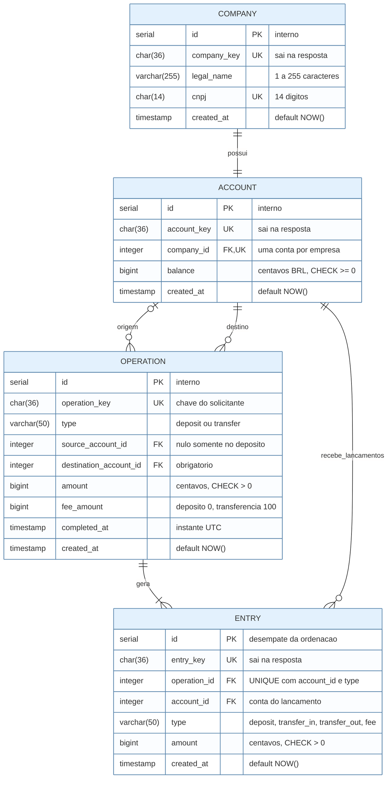
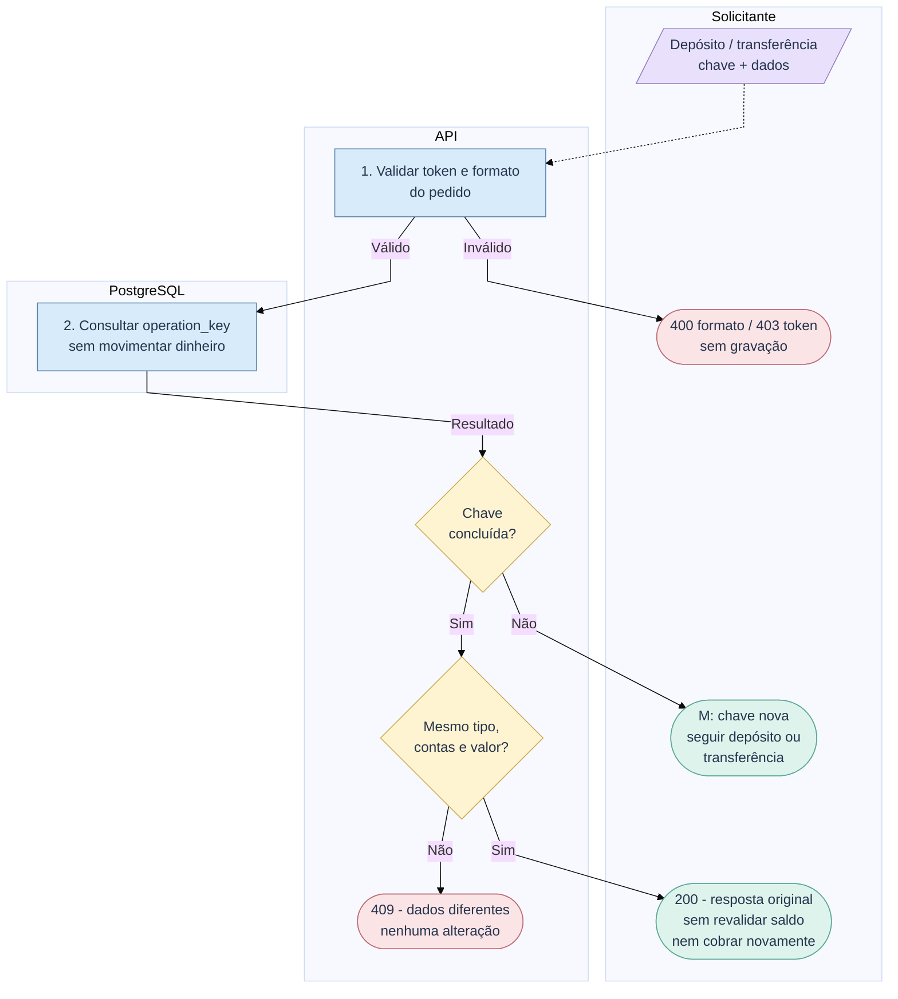
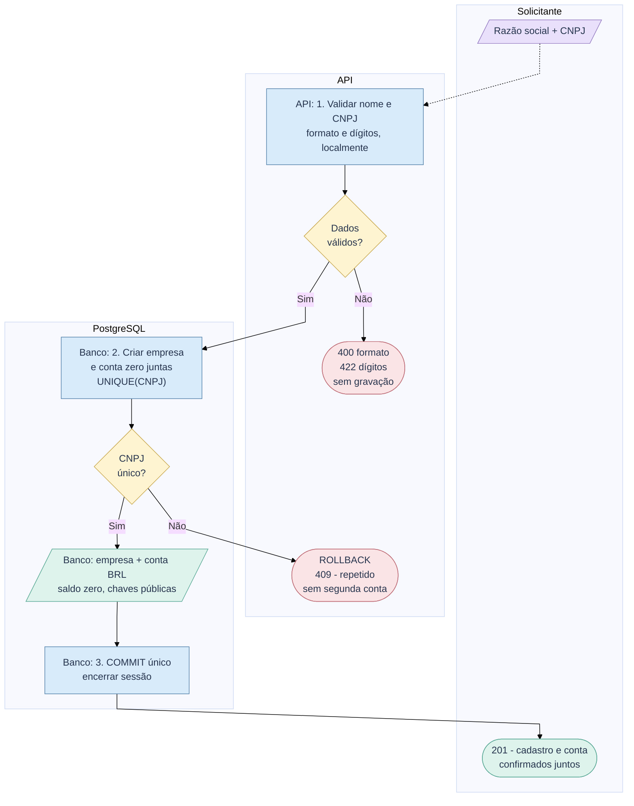
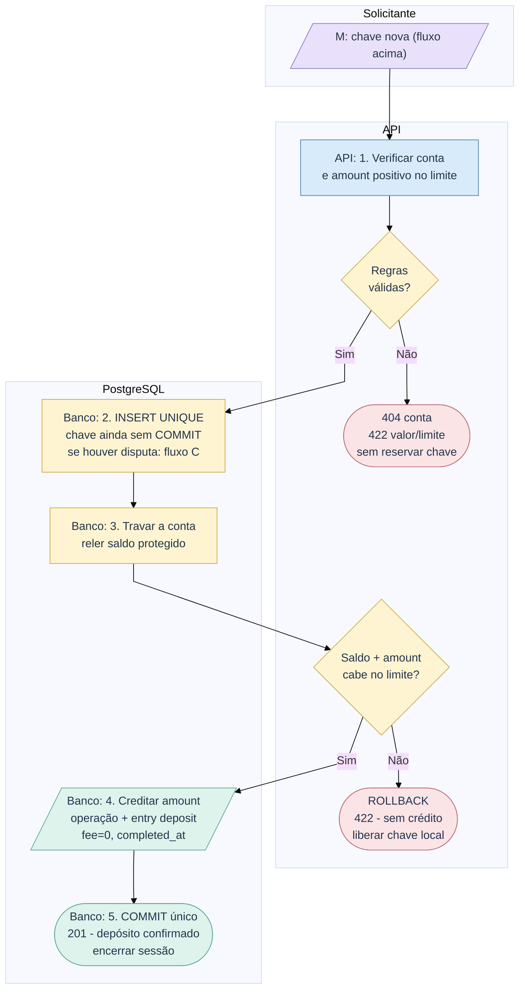
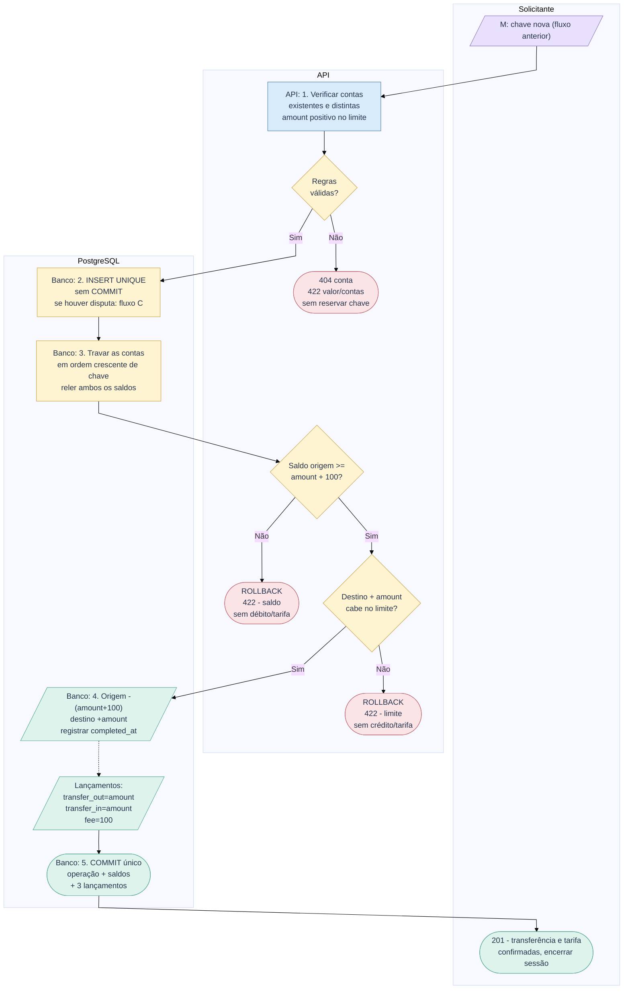
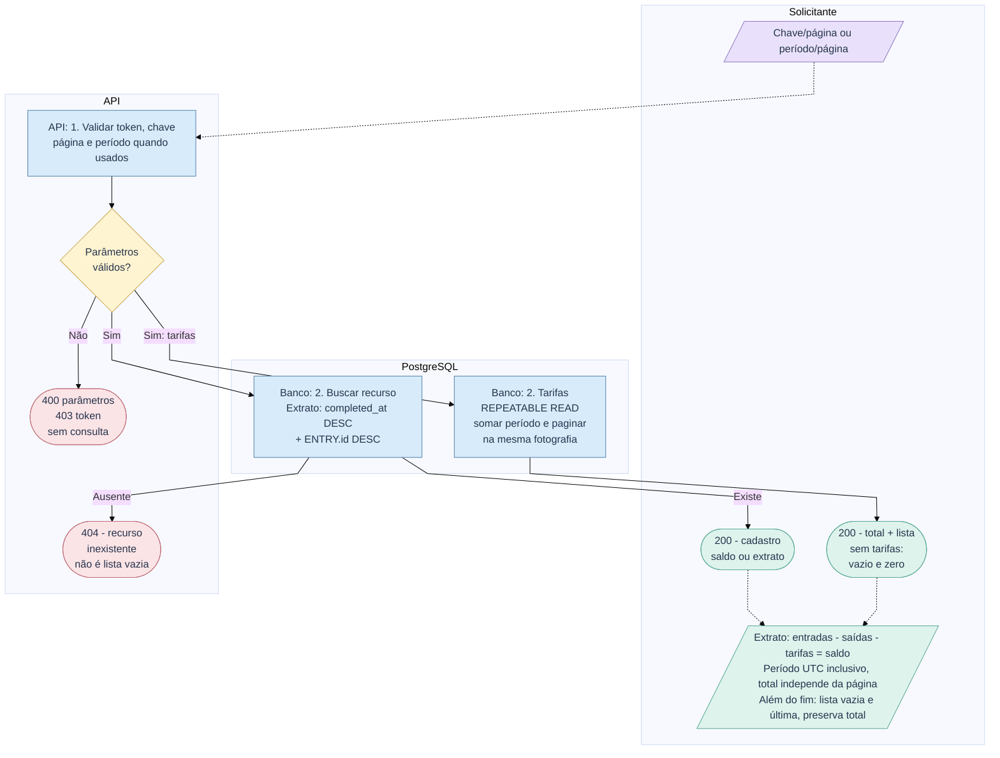
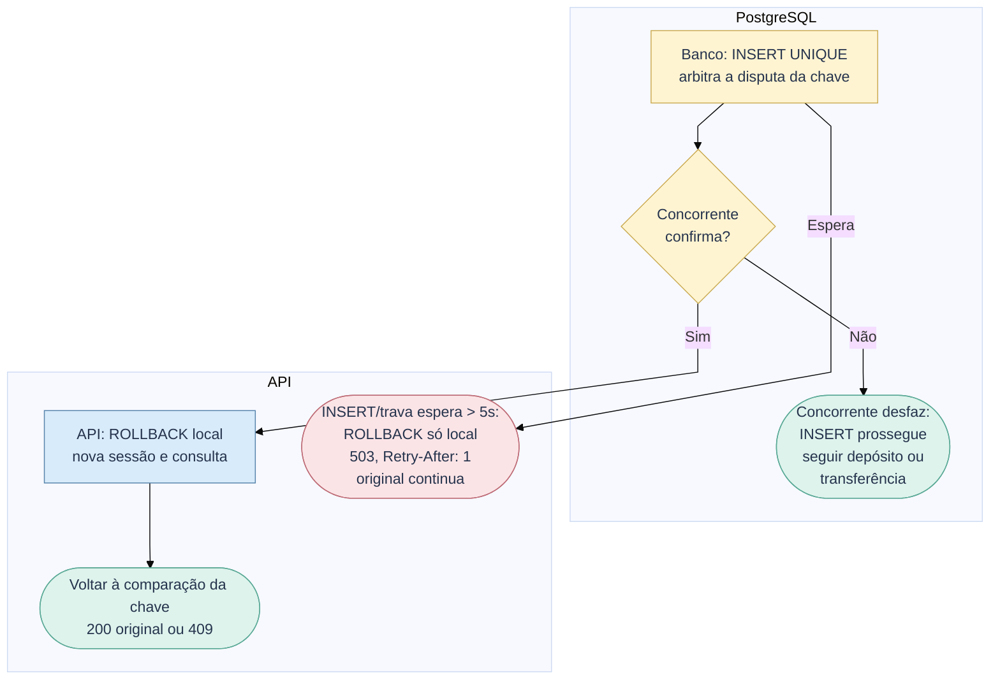

# RFC - Protótipo bancário empresarial

| | |
|---|---|
| **Time** | Bootcamp QI Tech |
| **Data** | 05/10/2026 |
| **Versão** | 3.0 |

## Contextualização

### Entendendo o problema

Empresas precisam de cadastro, conta vinculada, movimentação com saldo, tarifa na transferência e extrato paginado. O sistema contratante atende essas empresas. O adicional é a consulta de arrecadação do operador, para conferir cobranças e identificar operação e pagador; não se presume receita direta da QI. O dinheiro deve permanecer correto diante de falhas, pedidos repetidos e simultâneos. Ficam fora: interface, escalabilidade, pagamentos reais, integrações externas, múltiplas contas, crédito, estornos e agendamentos.

### Explicando a solução de forma macro

A API e o PostgreSQL guardam empresas, contas, operações e lançamentos. A conta guarda saldo em centavos; a transferência debita principal mais tarifa fixa de 100 e credita o principal no destino. Bloqueios e chave única protegem o saldo; a transação confirma tudo junto. A arrecadação soma as tarifas, sem conta movimentável do operador.

- Tarifa percentual: descartada pelo arredondamento; ganharia com preços comerciais diferenciados.
- Saldo calculado pelo extrato: exige somas a cada operação; ganharia para dispensar saldo armazenado.
- Conta/tabela de arrecadação separada: duplica estado; ganharia se o operador movimentasse esses recursos.
- Integrações reais e filas: introduzem falhas externas e estados intermediários; ganhariam em pagamentos externos.

## Implementação

### Rotas

JSON sem campos desconhecidos; UUIDs públicos. Valores monetários inteiros, sem strings, booleanos ou frações. CNPJ é string de 14 dígitos sem máscara, validada localmente; razão social: 1 a 255 caracteres após trim. Negócio exige `INTERNAL-TOKEN` (`403` inválido). Erros: `title`, `description`, `translation`, `code`.

| Método | Caminho | O que faz | Entrada (campos que importam) | Saídas (status e quando) |
|---|---|---|---|---|
| `GET` | `/` | Identifica o serviço; pública | - | `200` |
| `GET` | `/health_check` | Verifica a API; pública | - | `204`; não verifica o banco |
| `POST` | `/companies` | Cria empresa e conta zero | `legal_name`, `cnpj` | `201` chaves da empresa/conta; `400` formato; `409` CNPJ repetido; `422` dígitos inválidos |
| `GET` | `/companies/{company_key}` | Consulta cadastro e conta | `company_key` | `200` cadastro e conta; `400` chave inválida; `404` inexistente |
| `GET` | `/accounts/{account_key}` | Consulta titular e saldo | `account_key` | `200` conta, empresa, `balance`, BRL; `400` chave inválida; `404` inexistente |
| `POST` | `/deposits` | Depósito gratuito; idempotente | `operation_key`, `account_key`, `amount` | `201` novo; `200` repetido; `400` formato; `404` conta; `409` chave conflitante; `422` valor/limite; `503` trava; `500` falha interna |
| `POST` | `/transfers` | Transferência + tarifa; idempotente | `operation_key`, `source_account_key`, `destination_account_key`, `amount` | `201` nova; `200` repetida; `400` formato; `404` conta; `409` chave conflitante; `422` valor, contas iguais, saldo/limite; `503` trava; `500` falha interna |
| `GET` | `/accounts/{account_key}/statement` | Extrato paginado | `account_key`, `page=0` | `200`, inclusive vazio; `400` chave/página; `404` conta |
| `GET` | `/fees` | Tarifas e total do período | `start_date`, `end_date`, `page=0` | `200`, inclusive vazio; `400` datas, página ou intervalo invertido |

Páginas têm 20 itens, iniciam em zero: `data`, `page`, `page_size`, `is_last_page`. Datas: `YYYY-MM-DD`; instantes: UTC. Valores individuais usam BIGINT assinado; crédito excedente é recusado. Total é inteiro JSON, podendo exceder o limite individual sem perda.

<!-- pagebreak -->

**Idempotência:** depósitos/transferências usam `operation_key` única (`UNIQUE` global). Mesma chave, tipo, contas e valor recuperam a resposta original com `200`; divergência: `409`. Outra operação legítima usa chave nova; CNPJ repetido recebe `409`. O fluxo de repetição não movimenta saldo nem cobra tarifa.

**Ordenação:** extrato e tarifas usam `OPERATION.completed_at` e `ENTRY.id` decrescentes. Entradas e saídas são identificadas pelo tipo; principal e tarifa ficam separados.

**Operação e retentativa:** qualquer horário, sem rate limiting/`429`, sem promessa de capacidade/disponibilidade ilimitadas. UUID canônico de 36 caracteres, guardado antes do envio, persistente e sem expiração. Timeout/`5xx`/COMMIT incerto: mesma chave/dados após ao menos 1 segundo, respeitando `Retry-After`. `X-Request-ID` é só log. `503` usa `Retry-After: 1`.

### Banco de Dados (Somente diagrama)

<!-- pagebreak -->

### Fluxos

**Movimentações - validação e idempotência: sucesso e falhas**

**Leitura:** M = chave nova; C = disputa da chave. Passos numerados e decisões Sim/Não. Azul: processo; lilás: entrada; amarelo: decisão/trava; verde: registro/sucesso; vermelho: recusa.

**Cadastro - caminho feliz e falhas de validação/unicidade**

**Depósito - caminho feliz e falhas de conta/valor/limite**

<!-- pagebreak -->

**Transferência - caminho feliz e falhas de saldo/limite**

**Consultas - caminhos felizes e falhas de parâmetros/recurso**

**C: concorrência - confirmação, rollback e recuperação**

**Falha de gravação - cadastro, depósito e transferência:**

1. Antes do COMMIT: ROLLBACK de cadastro/conta ou operação/saldos/lançamentos; nas movimentações, liberar só a chave inserida pela tentativa. Encerrar sessão e responder `500` se possível.
2. COMMIT incerto/resposta perdida: reenviar mesma chave/dados, sem presumir rollback nem gravar estado pendente. `lock_timeout=5s` vale por espera de INSERT/trava, não pela chamada inteira.

> **Principal desafio**
>
> **Qual é:** impedir movimentação parcial, duplicada ou sem saldo.
>
> **Por que é difícil:** falhas, repetição e chamadas disputando o mesmo dinheiro.
>
> **Como resolve:** chave única comparada, contas travadas em ordem e COMMIT único de operação, saldos e lançamentos.
