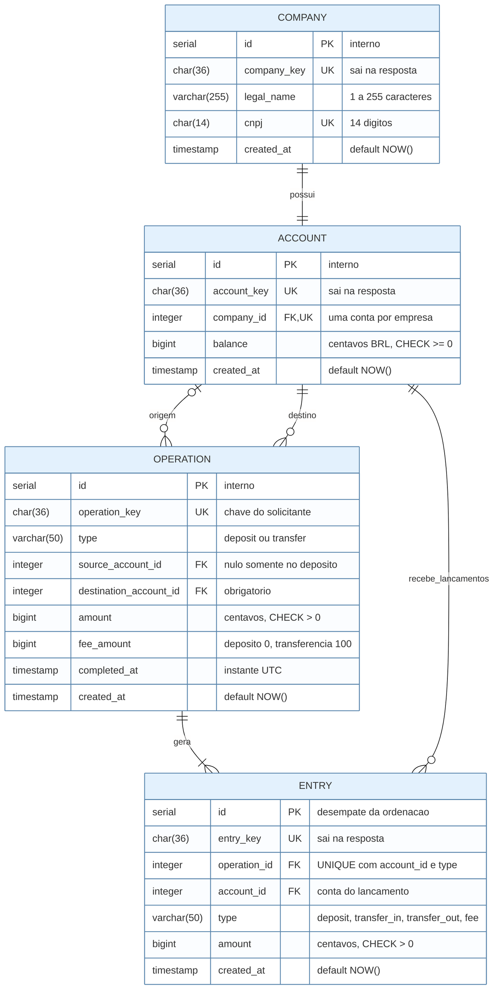
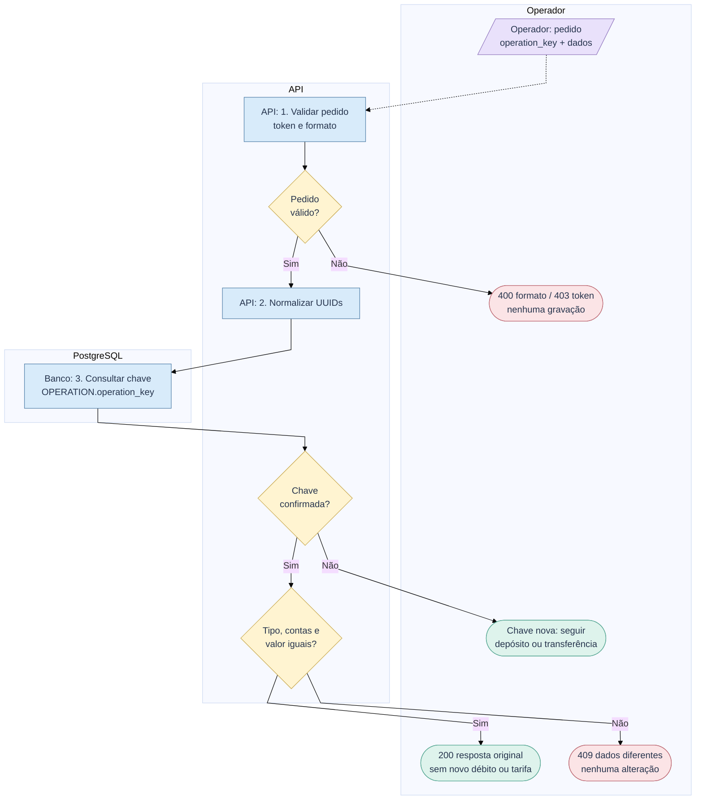
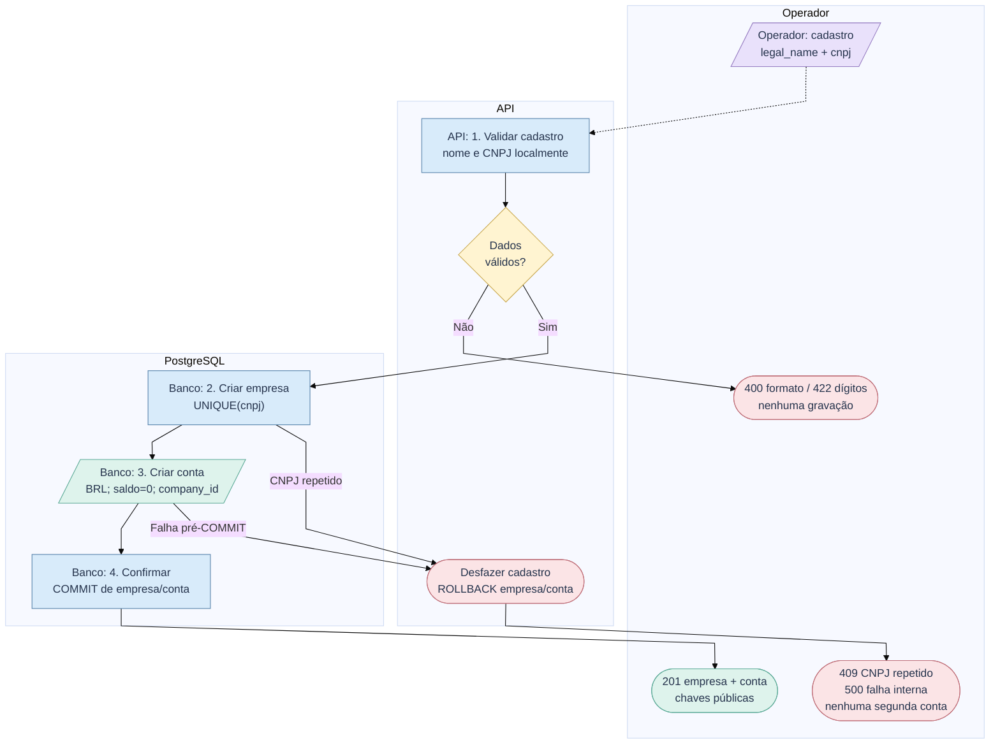
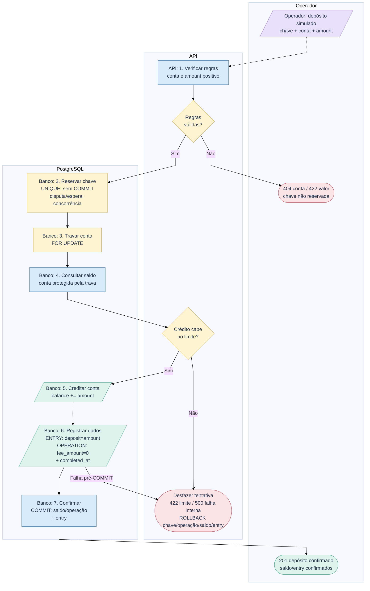
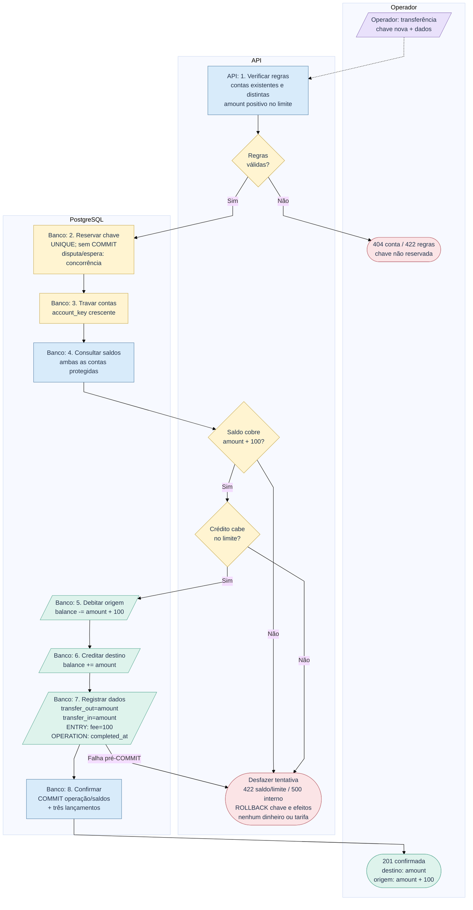
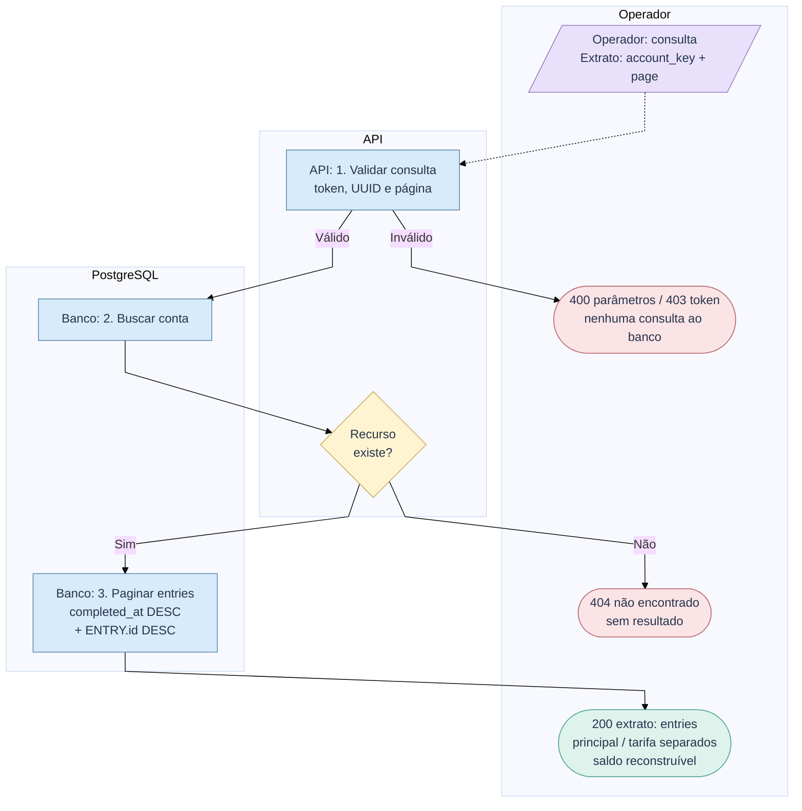
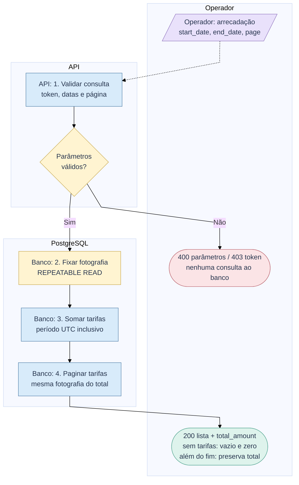

# RFC - Protótipo bancário empresarial

| | |
|---|---|
| **Time** | Bootcamp QI Tech |
| **Data** | 06/10/2026 |
| **Versão** | 5.0 |

## Contextualização

### Entendendo o problema

O banco ou fintech operador atende empresas com cadastro, conta, movimentações, tarifa e extrato paginado. Seu sistema consome a API; as empresas são titulares e pagadoras, sem acesso direto. O operador solicita depósitos simulados e transferências e consulta a arrecadação para conferir quanto cobrou e explicar cada tarifa. Deve impedir saldo divergente, duplicidade e execução parcial. Fora do escopo: interface, escalabilidade, pagamentos reais, integrações externas, múltiplas contas, crédito, estornos e agendamentos.

### Explicando a solução de forma macro

A API do projeto-base e o PostgreSQL registram empresas, contas, operações e lançamentos. Uma conta por empresa, centavos inteiros e tarifa fixa reduzem regras. Chave única, trava e confirmação conjunta preservam o dinheiro. A arrecadação soma os lançamentos de tarifa, sem conta movimentável do operador nem receita direta presumida da QI.

- Tarifa percentual: exige arredondamento; ganharia com preços comerciais diferenciados.
- Saldo pelo extrato: exige somas por operação; ganharia com baixo volume e sem saldo duplicado.
- Conta de arrecadação: duplica estado; ganharia se o operador movimentasse os recursos.
- Só cumprir o mínimo: registrar tarifas não oferece conferência por período; ganharia se o operador já a fizesse fora do serviço.

## Implementação

### Rotas

Recursos em inglês e no plural; `entries` representa os lançamentos do extrato. JSON sem campos desconhecidos; UUIDs públicos. Valores monetários inteiros, sem strings, booleanos ou frações. CNPJ é string de 14 dígitos sem máscara, validada localmente; razão social: 1 a 255 caracteres após trim. Negócio exige `INTERNAL-TOKEN` (`403` inválido). Erros: `title`, `description`, `translation`, `code`.

| Método | Caminho | O que faz | Entrada (campos que importam) | Saídas (status e quando) |
|---|---|---|---|---|
| `GET` | `/` | Identifica o serviço; pública | - | `200` |
| `GET` | `/health_check` | Verifica a API; pública | - | `204`; não verifica o banco |
| `POST` | `/companies` | Cria empresa e conta zero | `legal_name`, `cnpj` | `201` chaves da empresa/conta; `400` formato; `409` CNPJ repetido; `422` dígitos inválidos |
| `GET` | `/companies/{company_key}` | Consulta cadastro e conta | `company_key` | `200` cadastro e conta; `400` chave inválida; `404` inexistente |
| `GET` | `/accounts/{account_key}` | Consulta titular e saldo | `account_key` | `200` conta, empresa, `balance`, BRL; `400` chave inválida; `404` inexistente |
| `POST` | `/deposits` | Depósito gratuito; idempotente | `operation_key`, `account_key`, `amount` | `201` novo; `200` repetido; `400` formato; `404` conta; `409` chave conflitante; `422` valor/limite; `503` trava; `500` falha interna |
| `POST` | `/transfers` | Transferência + tarifa; idempotente | `operation_key`, `source_account_key`, `destination_account_key`, `amount` | `201` nova; `200` repetida; `400` formato; `404` conta; `409` chave conflitante; `422` valor, contas iguais, saldo/limite; `503` trava; `500` falha interna |
| `GET` | `/accounts/{account_key}/entries` | Extrato paginado | `account_key`, `page=0` | `200`, inclusive vazio; `400` chave/página; `404` conta |
| `GET` | `/fees` | Tarifas e total do período | `start_date`, `end_date`, `page=0` | `200`, inclusive vazio; `400` datas, página ou intervalo invertido |

**Dinheiro e horário:** BRL em centavos, dentro do limite de BIGINT assinado. Depósito simulado gratuito; transferência debita `amount + 100` na origem e credita `amount` no destino. Crédito excedente é recusado; total de tarifas é inteiro JSON sem o limite individual. Operações em qualquer horário, sem rate limiting/`429`; sem promessa de disponibilidade/capacidade ilimitadas.

<!-- pagebreak -->

**Idempotência:** depósitos/transferências exigem `operation_key`, UUID canônico de 36 caracteres do solicitante, com `UNIQUE` global em `OPERATION`, persistência após reinícios e sem expiração. Após validar formato e normalizar UUIDs, consultar a chave antes das regras de uma operação nova: conta existente, valor positivo no limite e contas distintas na transferência. Mesma chave, tipo, contas e valor: `200` com dados e instante originais; divergência: `409`, mesmo com valor zero/contas iguais. Outra operação exige chave nova. CNPJ repetido: `409`, sem recuperação de resposta.

**Retentativa:** nas movimentações, o operador guarda a chave antes do envio. Timeout, `5xx` ou COMMIT incerto: mesma chave/dados após ao menos 1 segundo, respeitando `Retry-After`. Espera de chave/trava excedida: `503`, `Retry-After: 1`; limite de 5s por espera, não por chamada. Outra chave aguarda a trava e relê o saldo antes de seguir. Resposta perdida não prova rollback. Só operações confirmadas ficam gravadas, sem estado pendente.

**Paginação:** 20 itens; `page` começa em zero; envelope `data`, `page`, `page_size`, `is_last_page`. Ordenar por `OPERATION.completed_at` e `ENTRY.id` decrescentes. Página além do fim: vazia e última; novas operações podem deslocar páginas. Extrato: valores positivos, tipo indica entrada/saída, principal separado da tarifa; entradas menos saídas/tarifas reconstruem saldo. `/fees`: datas obrigatórias `YYYY-MM-DD`, dias UTC inclusivos, total do período independente da página. Sem tarifas: vazio/zero; página além do fim mantém total. Instantes: ISO 8601 UTC.

**Respostas:** cadastro: `company_key`, `account_key`; empresa acrescenta `legal_name`, `cnpj`. Conta: `account_key`, `company_key`, `balance`, `currency=BRL`. Movimentações: `operation_key`, `amount`, `completed_at`; depósito acrescenta `account_key`; transferência, `source_account_key`, `destination_account_key`, `fee_amount`. Lançamentos: `entry_key`, `operation_key`, `amount`, `completed_at`; extrato acrescenta `type`; tarifa, `payer_account_key`. Envelope de tarifas acrescenta `start_date`, `end_date`, `total_amount`. IDs internos não saem.

**Erros (prefixo + sufixo):** base `QIT000`: `001` corpo/`010` parâmetros (`400`), `002` token (`403`), `404` rota (`404`), `405` método (`405`), `500` falha interna (`500`). Protótipo `QIT002`: `001` dígitos CNPJ (`422`), `002` CNPJ repetido (`409`), `003` empresa/`004` conta ausente (`404`), `005` valor não positivo/`006` contas iguais/`007` saldo insuficiente/`009` limite (todos `422`), `008` chave conflitante (`409`), `010` espera de bloqueio (`503`). Os códigos do protótipo não são catálogo comercial da QI.

### Banco de Dados (Somente diagrama)

<!-- pagebreak -->

### Fluxos

**Leitura:** azul: processo; lilás: entrada; amarelo: decisão/trava; verde: registro/sucesso; vermelho: recusa. Falha pré-COMMIT desfaz os efeitos.

**Movimentações - apoio comum de idempotência e concorrência**

Ao reservar a mesma `operation_key` em disputa:

1. Aguardar a transação concorrente pelo `INSERT UNIQUE`.
2. Se confirmar: ROLLBACK só local, nova sessão e consulta da chave; voltar à comparação.
3. Se desfizer: a própria inserção prossegue.
4. Espera acima de 5s: ROLLBACK só local; `503`, `Retry-After: 1`; a concorrente continua.

Com chaves diferentes, aguardar a trava da conta, reler o saldo e seguir a própria operação. Depósito e transferência iniciam com este apoio; disputas no INSERT seguem os passos acima.

**Cadastro - confirmação conjunta e falhas**

**Depósito - crédito gratuito e falhas**

<!-- pagebreak -->

**Transferência - saldo, tarifa e falhas**

**Extrato - paginação e conta inexistente**

**Arrecadação - período, total e falhas**

> **Principal desafio**
>
> **Qual é:** impedir movimentação parcial, duplicada ou sem saldo.
>
> **Por que é difícil:** falhas, repetição e chamadas disputando o mesmo dinheiro.
>
> **Como resolve:** chave única comparada, contas travadas em ordem e COMMIT único de operação, saldos e lançamentos.
