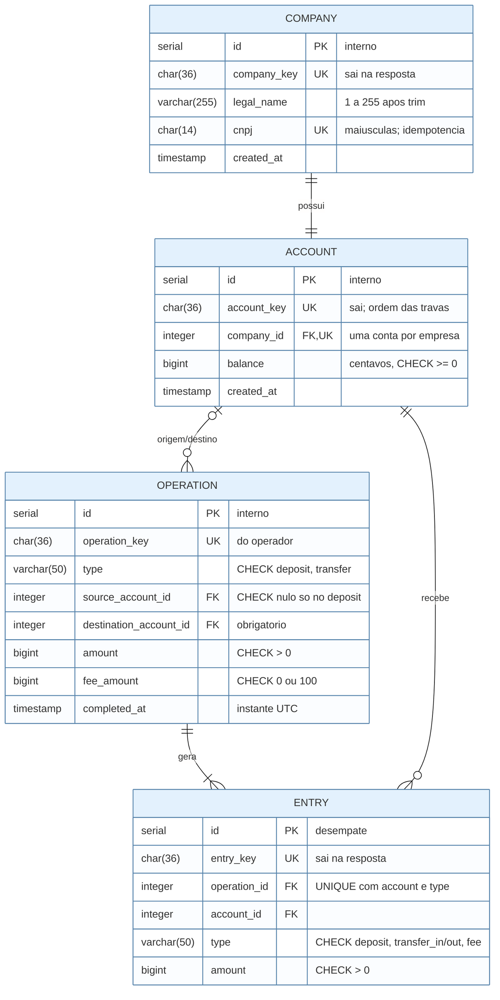
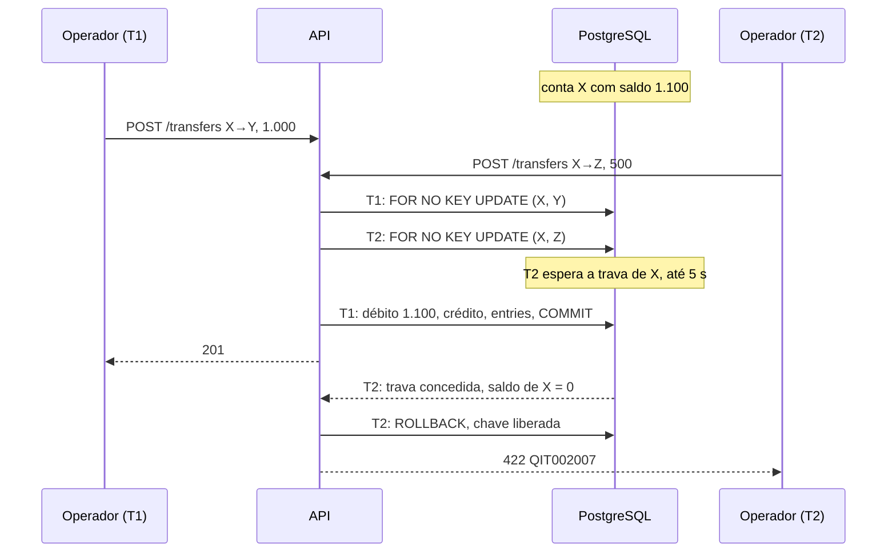

# RFC — Protótipo bancário empresarial: movimentação idempotente, contas travadas em ordem e tarifa conferível

| | |
|---|---|
| **Time** | Bootcamp QI Tech |
| **Data** | 10/10/2026 |
| **Versão** | 6.2 |

## Contextualização

### Entendendo o problema

Um banco ou fintech, o operador, atende empresas: cadastra cada uma com uma conta, lança depósitos simulados e transferências, cobra tarifa por transferência, mostra o extrato paginado e confere quanto arrecadou de tarifa num período. Quem chama a API é só o sistema do operador, com um token interno; as empresas são titulares e pagadoras, mas nunca chamam a API. O serviço sustenta três garantias. **Nada pela metade:** débito, crédito e tarifa acontecem juntos ou nenhum acontece; sem isso, sai dinheiro de uma conta sem chegar na outra. **Nada duas vezes:** um reenvio por timeout não debita de novo e o mesmo CNPJ não vira duas empresas; sem isso, a empresa paga em dobro. **Nada sem saldo:** duas transferências simultâneas não gastam o mesmo saldo e o extrato sempre reconstrói o saldo; sem isso, o banco empresta sem querer. Fora do escopo: interface, pagamentos reais, integrações externas, mais de uma conta por empresa, crédito, estorno, agendamento e metas de capacidade.

### Explicando a solução de forma macro

O projeto-base (Python, FastAPI, PostgreSQL, Docker) guarda `COMPANY`, `ACCOUNT`, `OPERATION` e `ENTRY`. O saldo mora numa coluna da conta, em centavos inteiros. Depósito e transferência são linhas de `OPERATION` separadas por `type`, e cada uma gera os lançamentos do extrato: um no depósito; três na transferência (saída, entrada e tarifa fixa de 100 centavos). Cada movimentação é uma transação só, sustentada por três mecanismos: a `operation_key` do operador, com `UNIQUE`, torna o reenvio seguro (o cadastro usa o CNPJ); `SELECT … FOR NO KEY UPDATE` nas contas, sempre em ordem crescente de `account_key`, impede que duas transferências gastem o mesmo saldo; e um `COMMIT` único impede o meio-termo. Resposta perdida se confere em `GET /operations/{operation_key}`. A arrecadação soma os lançamentos de tarifa, sem conta própria do operador (que seria um segundo saldo a manter igual à soma). Alternativas descartadas:

- **Não exigir chave de idempotência**, como no projeto-base: após um timeout, o operador escolhe entre talvez debitar duas vezes ou talvez perder a transferência. Ganharia se o operador nunca reenviasse.
- **Uma tabela por tipo:** o banco recusaria origem nula sem código, mas extrato, consulta por chave e unicidade da chave virariam uniões, e cada regra seria escrita duas vezes; em `OPERATION`, um `CHECK` cobre a origem. Ganharia se os tipos quase não tivessem campos em comum.
- **Uma rota só, `POST /operations` com `type`:** o corpo mudaria de forma conforme o tipo e o schema deixaria de recusar sozinho transferência sem origem; por isso duas rotas de escrita na mesma tabela. Ganharia com vários tipos de corpo igual.
- **Saldo pela soma do extrato:** some o risco de divergência, mas cada transferência somaria o histórico com a conta travada. Ganharia com pouco volume por conta.
- **Sem trava explícita (versão otimista ou `UPDATE … WHERE balance >= amount + 100`):** a otimista devolve conflito justo na disputa, e o `UPDATE` condicional também trava, na ordem das instruções: A→B e B→A simultâneas dão deadlock. Ganharia se a disputa pela mesma conta fosse rara.

## Implementação

### Rotas

Recursos em inglês e no plural. Todas as rotas, menos `/` e `/health_check`, exigem `INTERNAL-TOKEN` (`403 QIT000002`). Corpo fora do formato, inclusive campo desconhecido, string, fração ou booleano em `amount`: `400 QIT000001`; parâmetro fora do formato: `400 QIT000010`. Erros têm `title`, `description`, `translation` e `code`; os `QIT002…` são deste protótipo, não do catálogo da QI. Falha não prevista: `500 QIT000500`; espera de trava acima de 5 s: `503 QIT002010` com `Retry-After: 1` (nas três rotas de escrita).

| Método | Caminho | O que faz | Entrada | Saídas (status e quando) |
|---|---|---|---|---|
| `GET` | `/`, `/health_check` | Identificam o serviço e dizem se o processo está de pé, sem consultar o banco. Abertas | — | `200`; `204` |
| `POST` | `/companies` | Cria empresa e conta com saldo zero. Idempotente por `UNIQUE(cnpj)` | `legal_name`, `cnpj` | `201` nova, com `company_key` e `account_key`; `200` mesmo CNPJ e razão social, chaves originais; `409 QIT002002` CNPJ com outra razão social; `422 QIT002001` verificadores errados |
| `GET` | `/companies/{company_key}` | Empresa e conta | `company_key` | `200`; `404 QIT002003` |
| `GET` | `/accounts/{account_key}` | Titular e saldo | `account_key` | `200` com `balance` e `currency`; `404 QIT002004` |
| `POST` | `/deposits` | Depósito simulado, sem tarifa. Idempotente por `UNIQUE(operation_key)` | `operation_key`, `account_key`, `amount` | `201` novo; `200` repetido, resposta original; `404 QIT002004`; `409 QIT002008` mesma chave, outros dados; `422 QIT002005` valor não positivo, `QIT002009` acima do limite |
| `POST` | `/transfers` | Transferência; a origem paga `amount + 100`. Idempotente por `UNIQUE(operation_key)` | `operation_key`, `source_account_key`, `destination_account_key`, `amount` | `201`; `200`; `404 QIT002004`; `409 QIT002008`; `422 QIT002005`, `QIT002006` contas iguais, `QIT002007` saldo insuficiente, `QIT002009` limite |
| `GET` | `/operations/{operation_key}` | Confere uma movimentação, só leitura | `operation_key` | `200` dados originais e `type`; `404 QIT002011` sem `COMMIT` |
| `GET` | `/accounts/{account_key}/entries` | Extrato paginado | `account_key`, `page` | `200`, inclusive vazio; `404 QIT002004` |
| `GET` | `/fees` | Tarifas do período e total | `start_date`, `end_date`, `page` | `200`, inclusive vazio; `400 QIT000010` data inválida ou intervalo invertido |

**Formatos e dinheiro.** CNPJ: 14 caracteres sem máscara; 12 primeiros `A-Z` ou `0-9`, 2 verificadores numéricos por módulo 11 com valor ASCII − 48 (`A` = 17), também no CNPJ só numérico. Minúsculas viram maiúsculas antes de validar, gravar e comparar. Razão social: 1 a 255 caracteres após trim. Chaves: UUID canônico, comparado em minúsculas; nenhum id interno sai. Valores: inteiros em centavos, dentro do BIGINT; crédito que passaria do limite é `422 QIT002009`. Instantes em ISO 8601 UTC.

**Repetição.** A `operation_key` é gerada e guardada pelo operador antes do envio, tem `UNIQUE` global e não expira. A API procura a chave antes de qualquer regra: confirmada com o mesmo tipo, contas e valor, devolve `200` com a resposta e o `completed_at` originais, mesmo que o saldo de hoje já não permitisse; com qualquer dado diferente, `409`. No cadastro, o CNPJ em maiúsculas faz esse papel, comparando a razão social. Timeout ou `5xx` não provam que nada aconteceu: o operador consulta `GET /operations/{operation_key}` ou reenvia os mesmos dados após ao menos 1 s. Não existe estado pendente: só o que chegou ao `COMMIT` fica gravado.

**Paginação.** 20 itens, `page` a partir de 0, envelope `data`, `page`, `page_size`, `is_last_page`; ordem por `completed_at` e `ENTRY.id` decrescentes; além do fim, página vazia e última. No extrato, valores positivos e `type` indica o sentido. Em `/fees`, dias UTC inclusivos e `total_amount` do período inteiro, igual em qualquer página.

**Em produção.** *Quem chama:* só quem tem o token, lido de variável de ambiente; não há autorização por empresa porque nenhuma empresa chama a API. *Quanto espera:* nenhuma chamada para fora; só a trava, com `SET LOCAL lock_timeout = '5s'`. *Se repetir:* idempotência acima. *Como saber que falhou:* toda recusa tem classe e código em `src/errors/`; além de `ENTROU`/`SAIU` com `X-Request-ID`, o controller registra cada movimentação com `operation_key`, contas, valor e código, nunca o token; alarmes para `5xx` acima de 1% por 5 min e para alta de `503`.

### Banco de Dados (Somente diagrama)

### Fluxos

**Transferência — caminho feliz.** (1) Valida token e corpo. (2) Procura a `operation_key`; se existe, `200` ou `409` sem tocar em saldo. (3) Confere contas existentes e distintas e valor positivo no limite; recusado aqui, nada foi reservado. (4) Abre a transação com `lock_timeout` de 5 s e faz `INSERT` em `OPERATION`, reservando a chave sob `UNIQUE`. (5) `SELECT … FOR NO KEY UPDATE` das contas `ORDER BY account_key` e só então lê os saldos. (6) Confere se a origem cobre `amount + 100` e se o destino cabe no BIGINT. (7) Debita, credita, grava `transfer_out`, `transfer_in` e `fee` e preenche `completed_at`. (8) `COMMIT`, travas liberadas, `201`. O depósito segue os mesmos passos com uma conta e sem tarifa.

**Transferência — falha: duas transferências disputam o mesmo saldo**

T2 lê o saldo depois da trava e vê 0, então desfaz tudo, inclusive a reserva da chave. Como todas travam em ordem crescente de `account_key`, X→Y e Y→X simultâneas esperam uma pela outra sem deadlock. Espera acima de 5 s: T2 desfaz a própria transação e responde `503 QIT002010`; o reenvio com a mesma chave é seguro.

**Falha: a mesma chave chega duas vezes ou a resposta se perde.** Duas requisições com a mesma chave em paralelo: a segunda fica parada no índice `UNIQUE`. Se a primeira confirmar, a segunda desfaz só a própria transação, relê a chave e devolve `200` (ou `409` se os dados diferirem); se a primeira desfizer, a segunda segue como pedido novo. Resposta perdida: `GET /operations/{key}` devolve `200` com a resposta original ou `404 QIT002011`, e então o operador reenvia a mesma chave; se a tentativa anterior confirmar nesse meio-tempo, o reenvio devolve `200` sem novo débito.

**Cadastro.** Normaliza razão social e CNPJ (`400`/`422` sem consultar o banco); procura o CNPJ (mesma razão social: `200` com as chaves originais; outra: `409`); senão insere empresa e conta e faz `COMMIT` (`201`). CNPJ em paralelo segue o roteiro da mesma chave sobre `UNIQUE(cnpj)`. Falha entre empresa e conta: `ROLLBACK` das duas e `500`, nunca empresa sem conta.

**Consultas.** Parâmetro inválido: `400` sem tocar no banco. O extrato confere a conta (`404`) e pagina os lançamentos lendo 21 linhas para saber se a página é a última. `/fees` abre uma transação `REPEATABLE READ`: total e página saem da mesma fotografia, iguais mesmo com transferências confirmando durante a consulta.

> ## Principal desafio
>
> - **Qual é:** a transferência acontecer inteira, uma vez só e só com saldo, mesmo com reenvio, disputa pelo mesmo saldo e resposta perdida.
> - **Por que é difícil:** "ler, conferir e gravar" deixa um intervalo em que outra transferência lê o mesmo saldo, e "procurar a chave e gravar" deixa o mesmo intervalo para dois reenvios. Travar resolve, mas travas em ordem oposta geram deadlock. E falta de resposta não diz se houve `COMMIT`.
> - **Como o desenho resolve:** reserva da chave por `INSERT` sob `UNIQUE` na mesma transação do dinheiro; contas travadas com `FOR NO KEY UPDATE` em ordem crescente de `account_key`, saldo lido depois da trava (não `FOR UPDATE`: o `INSERT` da operação, feito antes para reservar a chave, tem FK para as contas e pega `FOR KEY SHARE` nelas, que conflita com `FOR UPDATE`; duas transferências sobre as mesmas contas davam deadlock mesmo com a ordem certa, o que os testes de concorrência revelaram); saldos, operação e lançamentos num único `COMMIT`; espera limitada a 5 s; e `GET /operations/{operation_key}` para recuperar a resposta.

### Estratégia de testes

Black box com `pytest` contra API e Postgres reais (`docker compose up`, `pytest -v`), só por HTTP, sem importar `src/`. Cada teste cria o próprio mundo pelas rotas, confere status, corpo e `code`, e toda recusa da tabela tem um teste que fica vermelho se deixar de barrar (TDD). Ao fim de cada cenário, nas contas do teste: nenhum saldo negativo; saldo igual ao extrato; soma dos saldos igual a depósitos menos tarifas; 1 lançamento por depósito e 3 por transferência; `total_amount` igual à soma das tarifas. **Concorrência:** N transferências com saldo para parte delas (só as que cabem passam); A→B e B→A (sem deadlock); mesma chave e mesmo CNPJ em paralelo (um `201`, demais `200`). **Retentativa:** resposta descartada, `GET /operations` e reenvio (`200` original); mesma chave com outros dados (`409`); reenvio após o saldo mudar (`200`, não `422`). **Validação e consultas:** CNPJ numérico, alfanumérico e em minúsculas; `amount` inválido e acima do BIGINT; primeira, última e além da última página; dias UTC inclusivos nas duas pontas do período. **Fora da caixa-preta**, por conexão direta ao Postgres como o `DbUtils` do projeto-base: trava segurada além dos 5 s (`503` com `Retry-After`, depois reenvio confirmado) e trigger que falha no `INSERT` de `ENTRY` (`500`, nada gravado).